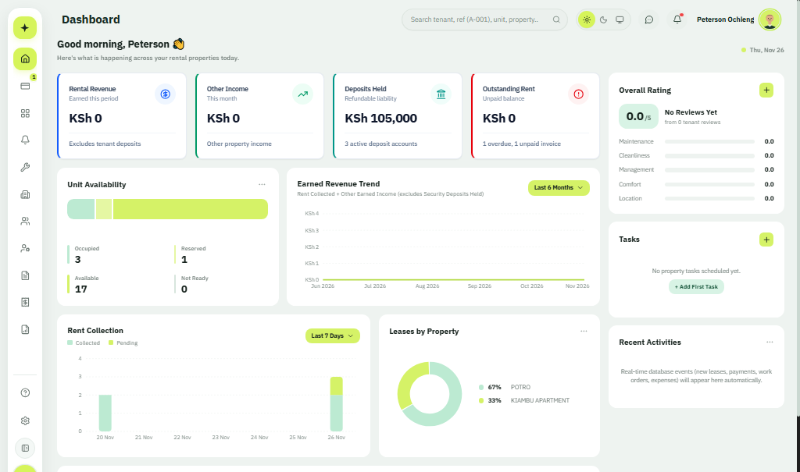
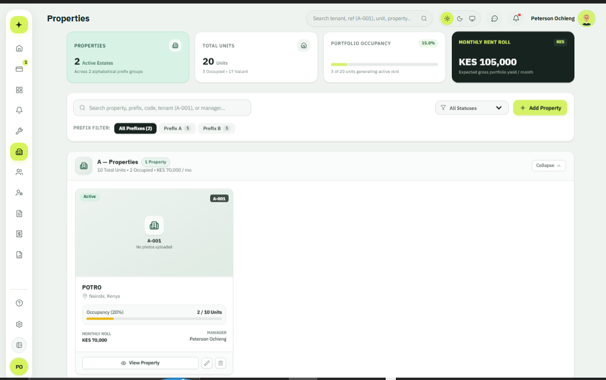
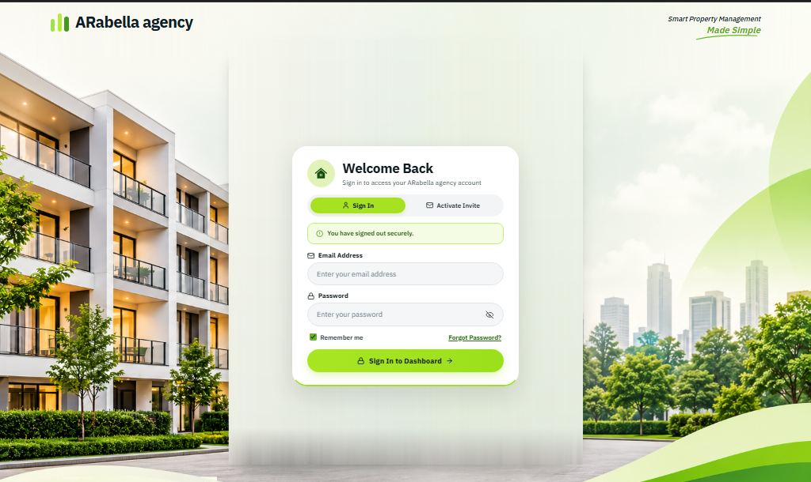

# Arabella RMS (`arabella-rms`)

**ARabella agency — Rental Property Management System**

Arabella RMS is a full-stack rental property management platform built for residential and commercial property portfolios. It unifies property and unit occupancy tracking, tenant onboarding, move-in anniversary billing, M-Pesa payment reconciliation via PayHero, strict separation of earned rental revenue from tenant security deposit liabilities, maintenance workflows, staff RBAC, and automated SMS/email notifications.

---

## Table of Contents

1. [Overview](#overview)
2. [Implemented Features](#implemented-features)
3. [Application Screenshots](#application-screenshots)
4. [Technology Stack](#technology-stack)
5. [System Architecture](#system-architecture)
6. [Anniversary Billing & Financial Accounting Rules](#anniversary-billing--financial-accounting-rules)
7. [PayHero Payment Architecture & Multi-PayBill Routing](#payhero-payment-architecture--multi-paybill-routing)
8. [Project Folder Structure](#project-folder-structure)
9. [Getting Started & Local Development](#getting-started--local-development)
10. [Environment Variables](#environment-variables)
11. [Deployment (Vercel & Supabase)](#deployment-vercel--supabase)
12. [Security Guidelines](#security-guidelines)
13. [Project Status & License](#project-status--license)

---

## Overview

Arabella RMS replaces manual spreadsheet tracking with an integrated management portal and tenant portal. Property owners, administrators, property managers, accountants, caretakers, and maintenance staff operate within role-scoped views, while tenants can inspect their lease details, anniversary billing schedules, downloadable PDF invoices/receipts, and maintenance tickets.

---

## Implemented Features

### 1. Executive & Financial Dashboard (`src/components/DashboardPage.tsx`)
- **Four Refined Financial Summary Cards**:
  - **Rental Revenue**: Earned rent collected during the period (strictly excludes refundable security deposits).
  - **Other Income**: Earned non-rent property income (penalties, utility/service charges, damage deductions).
  - **Deposits Held**: Refundable tenant security deposits tracked as a liability with active deposit account counts.
  - **Outstanding Rent**: Unpaid and overdue rental invoice balances with overdue/unpaid invoice counts.
- **Occupancy & Cashflow Analytics**: Real-time occupancy rate (`(Occupied Units / Total Units) × 100`), collection rate gauges, monthly cashflow charts (Recharts), and property-level performance breakdowns.
- **Task & Activity Feeds**: Property task checklists, tenant review summaries, and live activity logs.

### 2. Property & Unit Management (`src/components/PropertiesPage.tsx`, `src/components/UnitsPage.tsx`)
- **Multi-Property Portfolio**: Manage properties with unique property codes and prefixes (e.g., `A`, `B`, `C`), addresses, cover images, galleries, and assigned managers/caretakers.
- **Unit Categories & Individual Units**: Configure unit types (`Studio`, `1 Bedroom`, `2 Bedroom`, `3 Bedroom`, `Penthouse`, `Commercial`) with floor/size metadata, monthly rent, and maximum occupancy.
- **Synchronized Occupancy & Vacancy State**:
  - Real-time synchronization between unit status (`Occupied` / `Vacant`), active tenant assignments, and property-level unit counters.
  - Moving out a tenant or marking a unit as `Vacant` immediately decrements occupied counts, increments vacant counts, preserves historical tenancy records, and recalculates portfolio occupancy percentage.

### 3. Tenant Lifecycle & Deposit Settlement (`src/components/TenantProfilePage.tsx`)
- **Automated Tenant Account References**: Deterministic tenant account numbers generated from the property code prefix (e.g., `A-001`, `B-004`) used for M-Pesa PayBill reconciliation.
- **National ID / Passport Capture**: Dedicated identification field (`nationalId`) alongside emergency contacts, occupant counts, and lease terms.
- **Move-In & Move-Out Workflows**:
  - Tracks initial move-in rent and security deposit payments separately.
  - Full deposit settlement modal supporting deposit refunds (reducing deposit liability without reducing rental revenue) and itemized damage/arrears deductions (transferring deducted amounts to earned income categories).

### 4. Anniversary-Based Rental Billing & PDF Invoices (`src/lib/anniversaryBilling.ts`, `src/lib/pdfInvoiceBuilder.ts`)
- **Individual Move-In Anniversary Cycles**: Monthly billing cycles anchored strictly to each tenant's move-in date (`lease_start`), with automatic month-end clamping for 29th–31st move-in dates.
- **Automated Invoice Generation**: Background and on-demand generation of cycle invoices (`rent_payments`) with `billing_period_start`, `billing_period_end`, `due_date`, `amount_due`, `amount_paid`, and live status (`Paid`, `Pending`, `Overdue`).
- **Branded PDF Invoices & Receipts (`src/components/InvoicePreviewModal.tsx`)**: Vector PDF generation and in-app preview for both rental invoices and payment receipts.

### 5. Rent Payments & PayHero M-Pesa Integration (`src/components/RentPaymentsPage.tsx`)
- **Centralized PayHero Gateway**: Single PayHero API account supporting multiple manually mapped property PayBills or Till numbers (`payhero_paybills`).
- **Automated & Manual Reconciliation**: Matches incoming C2B webhook callbacks (`/api/webhooks/payhero`) and manual C2B entries (`/api/settings/payhero/manual-c2b`) against tenant references (`A-001`, `A001`, or property-scoped unit numbers).
- **Partial & Full Payment Tracking**: Cumulative tracking of `amount_paid` against `amount_due` on the tenant's oldest unpaid anniversary invoice.

### 6. Expenses, Maintenance, Messaging & Staff RBAC
- **Expense Ledger (`src/components/ExpensesPage.tsx`)**: Property-level operational expenses, vendor tracking, categories, and net operating income (NOI) impact.
- **Maintenance Requests (`src/components/MaintenancePage.tsx`)**: Priority levels (`Low`, `Medium`, `High`, `Urgent`), assigned technicians, cost estimates, and resolution tracking.
- **Internal & Tenant Messaging (`src/components/MessagesPage.tsx`)**: Multi-thread chat system between management and tenants.
- **Role-Based Access Control (`src/components/StaffPage.tsx`, `src/components/AuthGatePage.tsx`)**:
  - Supported roles: `super_admin`, `owner`, `administrator`, `property_manager`, `accountant`, `caretaker`, `maintenance_staff`, and `tenant`.
  - Property-scoped staff enforcement and staff invitation codes delivered via Resend email.
- **Automated Notifications (`src/lib/smsService.ts`, `src/lib/realtimeSms.ts`)**:
  - **Sozuri SMS Gateway**: Automated T-3 pre-due reminders, due-today alerts, overdue warnings, and payment confirmation SMS with delivery logs.
  - **Resend Transactional Email**: Branded HTML email notifications for invoices, payment confirmations, and staff invitations.

---

## Application Screenshots

### 1. Executive Financial & Occupancy Dashboard
Displays the four separated financial summary cards (**Rental Revenue**, **Other Income**, **Deposits Held** as a refundable liability, and **Outstanding Rent**), real-time **Unit Availability** counters (`Occupied`, `Reserved`, `Available`), **Earned Revenue Trend**, **Rent Collection**, and **Leases by Property**.



---

### 2. Properties & Portfolio Occupancy Management
Displays portfolio-level KPI cards (**Active Estates**, **Total Units** with occupied vs. vacant breakdown, **Portfolio Occupancy** percentage, and **Monthly Rent Roll**), prefix group filtering (`Prefix A`, `Prefix B`), and property cards showing property codes (`A-001`), occupancy progress bars, monthly rent roll, and assigned property managers.



---

### 3. Authentication & Staff Invitation Portal
Unified **ARabella agency** authentication gate supporting management and tenant sign-in (`Sign In`) as well as one-time staff invitation code activation (`Activate Invite`).



---

### Additional Module Captures (Optional Expansion)

The `public/images/screenshot/` directory currently contains `dashboard-overview.png`, `properties-units.png`, and `login-portal.png` (alongside the login background asset `public/images/login-bg.png`). To include visual captures for additional modules, place them in `public/images/screenshot/` using the paths below:

| Module View | Path in Repository | Status |
|---|---|---|
| **Financial & Occupancy Dashboard** | `public/images/screenshot/dashboard-overview.png` | Embedded above |
| **Properties & Portfolio Occupancy Management** | `public/images/screenshot/properties-units.png` | Embedded above |
| **Authentication & Invitation Portal** | `public/images/screenshot/login-portal.png` | Embedded above |
| **Tenant Profile & Anniversary Billing Ledger** | `public/images/screenshot/tenant-profile.png` | *(Optional — add file to display)* |
| **Rent Payments & PayHero Reconciliation** | `public/images/screenshot/rent-payments.png` | *(Optional — add file to display)* |

---

## Technology Stack

| Layer | Technology | Version / Package | Purpose |
|---|---|---|---|
| **Frontend UI** | React + TypeScript | `react@^19.0.1`, `typescript@^7.0.2` | Component-driven SPA for management and tenant portals |
| **Build Tool** | Vite | `vite@^8.3.0`, `@vitejs/plugin-react@^6.1.1` | Frontend bundling and dev asset pipeline |
| **Styling & Motion** | Tailwind CSS v4 + Motion + Lucide | `tailwindcss@^4.3.3`, `motion@^12.23.24`, `lucide-react@^0.546.0` | Responsive styling, dark/light theme engine, icons, and transitions |
| **Data Visualization** | Recharts | `recharts@^3.10.1` | Cashflow, revenue, expense, and occupancy charts |
| **Backend Server** | Node.js + Express | `express@^4.21.2`, `tsx@^4.21.0` | REST API (`/api/*`), webhook processing, RBAC middleware, and cron schedulers |
| **Realtime Events** | WebSockets (`ws`) + SSE | `ws@^8.22.1` | Live UI synchronization (`/ws/realtime` and `/api/realtime/events`) |
| **Primary Database & Auth** | Supabase (PostgreSQL + Auth) | `@supabase/supabase-js@^2.118.0` | Cloud database persistence, RLS policies, and authentication |
| **Local Fallback Engine** | PGlite (Embedded PostgreSQL) | `@electric-sql/pglite@^0.5.15` | Automatic local SQL migration execution and offline/fallback resiliency |
| **Payments** | PayHero Kenya API | REST / Webhook (`/api/webhooks/payhero`) | M-Pesa C2B PayBill callbacks, STK Push, and multi-PayBill routing |
| **Email Delivery** | Resend API | REST (`https://api.resend.com/emails`) | Staff invitations, invoice reminders, and payment receipts |
| **SMS Gateway** | Sozuri SMS API | REST (`src/lib/smsService.ts`) | Tenant rent reminders, overdue alerts, and payment confirmations |
| **Hosting & Cron** | Vercel | `@vercel/node@^30.0.0`, `vercel.json` | Serverless API routing (`/api/index.ts`), SPA rewrites, and daily cron jobs |

---

## System Architecture

```text
┌───────────────────────────────────────────────────────────────────────────┐
│                         React 19 + Vite Frontend                          │
│  Dashboard • Properties • Units • Tenants • Payments • Expenses • Staff   │
│         (src/App.tsx, src/components/*, src/lib/apiClient.ts)             │
└─────────────────────┬───────────────────────────────────┬─────────────────┘
                      │ REST (/api/*) + SSE/WebSocket     │ Client Auth / RLS
                      ▼                                   ▼
┌─────────────────────────────────────────────┐   ┌─────────────────────────┐
│        Node.js + Express Backend API        │   │      Supabase Auth      │
│      (server.ts / Vercel api/index.ts)      │   │  & PostgreSQL Database  │
│  • RBAC & Session Middleware                │◄──┤  (17 SQL Migrations in  │
│  • Anniversary Billing Engine               │   │   supabase/migrations/) │
│  • Revenue vs. Deposit Classification       │   └─────────────────────────┘
│  • PGlite Local Mirror & State Cache        │
└──────┬──────────────────────┬───────────────┴──────────┐
       │                      │                          │
       ▼                      ▼                          ▼
┌──────────────────┐   ┌──────────────────────┐   ┌─────────────────────────┐
│  PayHero Kenya   │   │   Sozuri SMS API     │   │    Resend Email API     │
│  M-Pesa Gateway  │   │ (Pre-due, Due-today, │   │ (Staff Invites, Branded │
│ C2B & Webhooks   │   │  Overdue & Receipts) │   │  Invoices & Alerts)     │
└──────────────────┘   └──────────────────────┘   └─────────────────────────┘
```

---

## Anniversary Billing & Financial Accounting Rules

### 1. Move-In Anniversary Billing (`src/lib/anniversaryBilling.ts`)
Unlike calendar-month billing systems that force all tenants onto the 1st of the month, Arabella RMS calculates each tenant's billing cycle strictly from their move-in date (`lease_start` / `move_in_date`) in the `Africa/Nairobi` (`UTC+3`) timezone:
- **Standard Cycle**: A tenant moving in on `22 November 2026` has Cycle 0 from `22 Nov 2026 – 21 Dec 2026` (Due: `22 Nov 2026`, Next Billing: `22 Dec 2026`).
- **Month-End Clamping**: A tenant moving in on the `31st` of January is billed on `28 Feb` (or `29 Feb` in a leap year) for Cycle 1, and automatically returns to the `31st` in March.
- **Automated Cycle Progression**: The backend (`ensureAnniversaryInvoicesForAllTenants`) automatically generates missing historical and current cycle invoices without duplicating existing records.

### 2. Revenue vs. Security Deposit Separation (`src/lib/paymentClassification.ts`)
Every transaction is classified into one of three accounting categories:
1. **`Rent`**: Earned rental revenue.
2. **`Other Income`**: Earned non-rent income (late fees, service/utility charges, damage deductions from deposits).
3. **`Security Deposit`**: Tenant deposit payments held as a refundable liability.

**Accounting Invariants Enforced Across All Views & Reports**:
- **Total Revenue** = `Rent Collected + Other Income` (never includes `Security Deposit`).
- **Deposits Held** = `Total Deposits Collected - Deposit Refunds - Deposit Deductions Applied`.
- **Deposit Refunds** reduce the `Deposits Held` liability and never reduce `Rental Revenue`.
- **Deposit Deductions** (for damages or unpaid rent upon move-out) reduce `Deposits Held` and transfer the deducted amount to the appropriate earned revenue category.

---

## PayHero Payment Architecture & Multi-PayBill Routing

Arabella RMS integrates with **PayHero Kenya** using a single centralized API credential set while supporting multiple property-specific M-Pesa PayBill or Till numbers:

1. **Centralized Credentials**: Configured once via environment variables (`PAYHERO_API_USERNAME`, `PAYHERO_API_PASSWORD`, `PAYHERO_BASIC_AUTH_TOKEN`, `PAYHERO_ACCOUNT_ID`, `PAYHERO_DEFAULT_CHANNEL_ID`).
2. **Property-to-PayBill Mapping (`payhero_paybills` table & `/api/settings/payhero/paybills`)**:
   - Administrators map specific PayBill/Till numbers and PayHero Channel IDs to individual properties (or a portfolio-wide default) in **Settings → Payment Gateway**.
   - Each property has a code prefix (e.g., `A`, `B`), and each tenant receives an account reference (e.g., `A-001`).
3. **End-to-End C2B Reconciliation Workflow**:
   - Tenant pays via M-Pesa using the property's PayBill number and their Tenant Account Reference (`A-001`).
   - PayHero sends a webhook callback to `POST /api/webhooks/payhero` (or an accountant logs a payment via `POST /api/settings/payhero/manual-c2b`).
   - `reconcileAndRecordPayHeroC2B` resolves the property from the PayBill mapping and matches the tenant by exact reference (`A-001`), unhyphenated reference (`A001`), or unit number within the mapped property.
   - The payment is applied to the tenant's oldest unpaid anniversary invoice, updating `amount_paid`, `status` (`Paid` or `Partial Payment`), and the tenant's outstanding balance, then logs the receipt in `payhero_transactions` and triggers SMS/email confirmation.

---

## Project Folder Structure

```text
arabella-rms/
├── api/
│   └── index.ts                  # Vercel serverless entry point wrapping server.ts
├── public/
│   ├── images/
│   │   ├── screenshot/
│   │   │   ├── dashboard-overview.png # Financial summary & occupancy dashboard screenshot
│   │   │   ├── login-portal.png       # ARabella agency login & invitation portal screenshot
│   │   │   └── properties-units.png   # Properties & portfolio occupancy manager screenshot
│   │   └── login-bg.png          # Login screen architectural background asset
│   └── uploads/                  # Local upload storage directory
├── scripts/
│   ├── test-sms.ts               # CLI diagnostic script for SMS service verification
│   └── test_sozuri.ts            # CLI diagnostic script for Sozuri gateway testing
├── src/
│   ├── components/
│   │   ├── AnimatedMetrics.tsx   # Animated counters, progress bars, and gauge widgets
│   │   ├── AuthGatePage.tsx      # Management & Tenant login, password setup, and invite verification
│   │   ├── DashboardPage.tsx     # Financial summary cards, occupancy metrics, and cashflow charts
│   │   ├── ExpensesPage.tsx      # Property expense tracking and category analytics
│   │   ├── InvoicePreviewModal.tsx # In-app branded invoice and payment receipt previewer
│   │   ├── LayoutShell.tsx       # Sidebar navigation, header, notifications, and role switcher
│   │   ├── MaintenancePage.tsx   # Maintenance work orders, statuses, and vendor assignment
│   │   ├── MessagesPage.tsx      # Management-to-tenant communication threads
│   │   ├── PortfolioViews.tsx    # Portfolio-level property & financial comparison views
│   │   ├── PropertiesPage.tsx    # Property CRUD, image galleries, and occupancy summaries
│   │   ├── RentPaymentsPage.tsx  # Invoice ledger, payment recording, and deposit tracking
│   │   ├── SettingsPage.tsx      # System, PayHero PayBills, SMS (Sozuri), Email (Resend), and backup settings
│   │   ├── StaffPage.tsx         # Staff accounts, RBAC permissions, and invitation management
│   │   ├── TenantProfilePage.tsx # Tenant onboarding, lease editor, anniversary ledger, and vacate/deposit settlement
│   │   ├── UnitIllustration.tsx  # SVG architectural illustrations for unit types
│   │   └── UnitsPage.tsx         # Unit inventory, unit categories, and Occupied/Vacant status toggles
│   ├── data/
│   │   └── rentalData.ts         # Core TypeScript interfaces, role definitions, and initial seed schemas
│   ├── lib/
│   │   ├── anniversaryBilling.ts # Move-in anniversary cycle engine and invoice status calculator
│   │   ├── apiClient.ts          # Frontend API client with timeout retry and Supabase fallback
│   │   ├── invoiceGenerator.ts   # HTML/print invoice and receipt template builder
│   │   ├── invoiceTheme.ts       # Shared brand palette and typography tokens for invoices
│   │   ├── paymentClassification.ts # Revenue vs. Security Deposit vs. Other Income accounting engine
│   │   ├── pdfInvoiceBuilder.ts  # Direct PDF binary generator for downloadable invoices & receipts
│   │   ├── realtimeSms.ts        # Real-time SMS & SSE client event subscriptions
│   │   ├── smsService.ts         # Sozuri SMS gateway client and phone number normalization
│   │   ├── supabaseClient.ts     # Browser Supabase client initialization and diagnostics
│   │   └── useThemeState.ts      # Dark/light mode, accent color, and font preference hook
│   ├── App.tsx                   # Top-level application state, routing, and real-time sync
│   ├── index.css                 # Tailwind CSS v4 global stylesheet and theme tokens
│   └── main.tsx                  # React DOM entry point
├── supabase/
│   └── migrations/               # 17 sequential SQL migration files (001 through 017)
├── .env.example                  # Documented environment variable template
├── index.html                    # HTML entry point with flash-free theme hydration script
├── metadata.json                 # Application metadata descriptor
├── package.json                  # Scripts and dependency manifest (arabella-rms)
├── server.ts                     # Express backend API, PGlite bootstrap, PayHero webhooks, and schedulers
├── tsconfig.json                 # TypeScript compiler configuration
├── vercel.json                   # Vercel serverless function bundling, rewrites, and daily cron schedule
└── vite.config.ts                # Vite build and Tailwind v4 plugin configuration
```

---

## Getting Started & Local Development

### Prerequisites

- **Node.js** `v20+` (or `v22+` recommended)
- **npm** `v10+`
- **Supabase Project** (optional for local testing due to built-in PGlite embedded PostgreSQL fallback, required for cloud persistence)

### 1. Clone the Repository

```bash
git clone <YOUR_GITHUB_REPOSITORY_URL>
cd arabella-rms
```

### 2. Install Dependencies

```bash
npm install
```

### 3. Configure Environment Variables

Copy `.env.example` to `.env` and populate your credentials:

```bash
cp .env.example .env
```

### 4. Apply Supabase Migrations (Cloud Database)

If connecting to a live Supabase project, execute the SQL files located in `supabase/migrations/` (`001_rental_management_schema.sql` through `017_fix_tenant_edit_billing_sync.sql`) in your Supabase SQL Editor.  
*(Note: On local startup, `server.ts` also automatically applies these migrations into its embedded PGlite instance.)*

### 5. Start the Development Server

```bash
npm run dev
```

This runs `tsx server.ts --port 3000`, which starts the Express API server, mounts the Vite development middleware, initializes the database state cache, and serves the application at:

```text
http://localhost:3000
```

### Available npm Scripts (`package.json`)

| Command | Action |
|---|---|
| `npm run dev` | Starts the full-stack Express + Vite development server on port `3000` (`tsx server.ts --port 3000`) |
| `npm run build` | Builds the production frontend bundle into `dist/` (`vite build`) |
| `npm start` | Starts the production Node.js/Express server (`tsx server.ts`) |
| `npm run preview` | Previews the built Vite frontend bundle (`vite preview`) |
| `npm run lint` | Runs TypeScript type-checking across the project (`tsc --noEmit`) |
| `npm run clean` | Removes build artifacts (`rm -rf dist server.js`) |

---

## Environment Variables

All environment variables are defined in `.env.example`.

| Variable | Scope | Description |
|---|---|---|
| `APP_URL` | Server | Public base URL where the app is hosted (e.g., `http://localhost:3000` or your production domain). Used for invitation links and PayHero webhook callback URLs. |
| `VITE_SUPABASE_URL` | Client & Build | Your Supabase project URL (`https://<project-ref>.supabase.co`). Must be present at Vite build time. |
| `VITE_SUPABASE_ANON_KEY` | Client & Build | Your Supabase public anonymous key (`anon` key) for browser authentication and RLS-protected queries. |
| `SUPABASE_URL` | Server-only | Your Supabase project URL used by `server.ts`. |
| `SUPABASE_SERVICE_ROLE_KEY` | Server-only | **Secret.** Supabase `service_role` key used exclusively by `server.ts` for admin operations, webhook reconciliation, and background cron jobs. Never expose with a `VITE_` prefix. |
| `RESEND_API_KEY` | Server-only | **Secret.** Resend API key (`re_...`) for sending staff invitations and automated rental invoice/receipt emails. |
| `RESEND_FROM_EMAIL` | Server-only | Verified sender address for outbound emails (e.g., `Rentify Management <onboarding@resend.dev>`). |
| `SOZURI_PROJECT` | Server-only | Sozuri SMS project identifier. |
| `SOZURI_API_KEY` | Server-only | **Secret.** Sozuri SMS gateway API key for outbound tenant SMS notifications. |
| `SOZURI_SENDER_ID` | Server-only | Approved alphanumeric Sender ID (default: `ARABELLA`). |
| `PAYHERO_API_USERNAME` | Server-only | **Secret.** PayHero Kenya API username for the centralized merchant account. |
| `PAYHERO_API_PASSWORD` | Server-only | **Secret.** PayHero Kenya API password. |
| `PAYHERO_BASIC_AUTH_TOKEN` | Server-only | **Secret.** Pre-encoded Base64 Basic Auth token for PayHero API requests. |
| `PAYHERO_ACCOUNT_ID` | Server-only | PayHero account ID. |
| `PAYHERO_DEFAULT_CHANNEL_ID` | Server-only | Default PayHero payment channel ID when a property does not override it. |
| `PAYHERO_WEBHOOK_SECRET` | Server-only | **Secret.** Secret token used to verify incoming PayHero webhook callbacks. |

---

## Deployment (Vercel & Supabase)

The repository is pre-configured for **Vercel** deployment via `vercel.json` and `api/index.ts`.

1. **Serverless API Routing**:
   - `vercel.json` routes all `/api/(.*)` requests to `api/index.ts`, which boots the Express application exported by `server.ts`.
   - Required runtime files (`server.ts`, `src/data/rentalData.ts`, `src/lib/smsService.ts`, `src/lib/anniversaryBilling.ts`, `src/lib/pdfInvoiceBuilder.ts`, `src/lib/invoiceTheme.ts`, and `supabase/migrations/**`) are bundled via `includeFiles`.
2. **SPA Fallback Rewrite**:
   - Non-API, non-asset routes rewrite cleanly to `/index.html`.
3. **Automated Daily Cron Job**:
   - `vercel.json` configures a daily cron job at `05:00 UTC` (`08:00 EAT`, Nairobi time):
     - **Path**: `/api/sms/run-automated-checks`
     - **Schedule**: `0 5 * * *`
   - This job evaluates all active tenants' anniversary billing cycles, generates due invoices, and dispatches scheduled SMS and email reminders.
4. **PayHero Webhook Configuration**:
   - In your PayHero dashboard, set the C2B / STK callback URL to:
     ```text
     https://<your-production-domain>/api/webhooks/payhero
     ```
5. **Vercel Environment Variables**:
   - Add all variables from `.env.example` in **Vercel → Project Settings → Environment Variables** before deploying so both the Vite frontend build (`VITE_SUPABASE_URL`, `VITE_SUPABASE_ANON_KEY`) and the serverless API (`SUPABASE_SERVICE_ROLE_KEY`, `PAYHERO_*`, `SOZURI_*`, `RESEND_*`) are properly configured.

---

## Security Guidelines

- **Zero Secret Exposure in Frontend**: Never prefix `SUPABASE_SERVICE_ROLE_KEY`, `RESEND_API_KEY`, `SOZURI_API_KEY`, or any `PAYHERO_*` credential with `VITE_`. Only `VITE_SUPABASE_URL` and `VITE_SUPABASE_ANON_KEY` are exposed to the browser bundle.
- **Role-Based Access Control (RBAC)**: Every mutating backend route in `server.ts` enforces session verification (`resolveUserMiddleware`) and role permissions (`requireRole`), plus property-scope isolation for property-assigned staff (`property_manager`, `caretaker`, `maintenance_staff`).
- **Audit Logging**: Sensitive operations—including login attempts, permission denials, staff invitations, deposit settlements, PayBill changes, and database exports—are recorded in the security audit trail.
- **Git Hygiene**: Never commit `.env` files, real API keys, database dumps, or tenant PII to version control.

---

## Project Status & License

**Status**: Actively developed production Rental Management System (`arabella-rms`).

**License**: Proprietary software. Unauthorized copying, redistribution, modification, or commercial use is prohibited without explicit written permission from the project owner.
